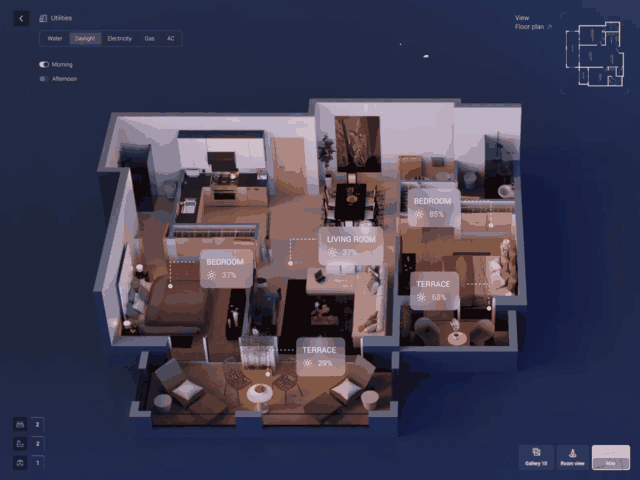
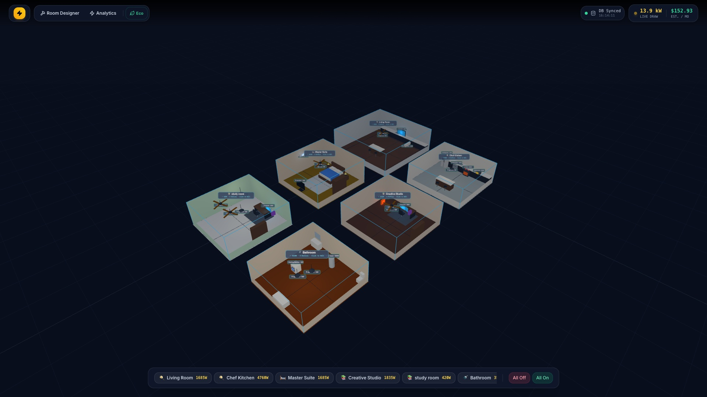
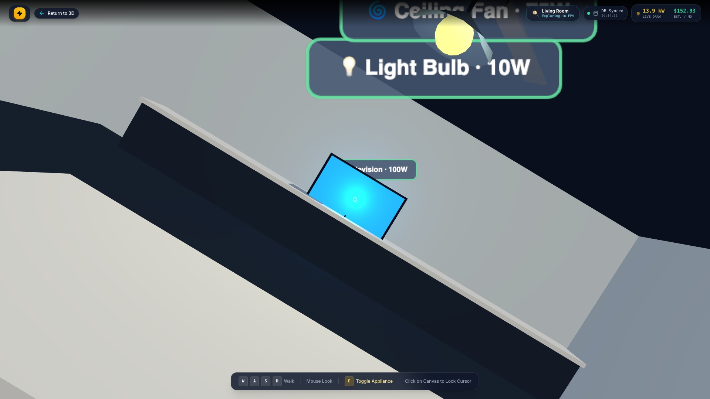
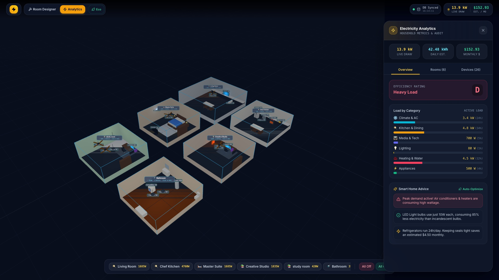
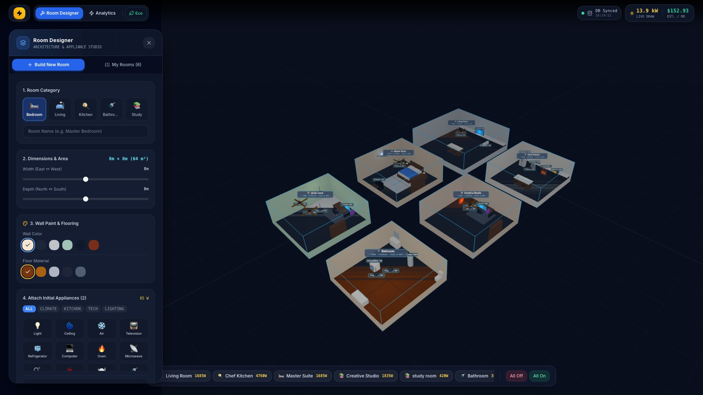
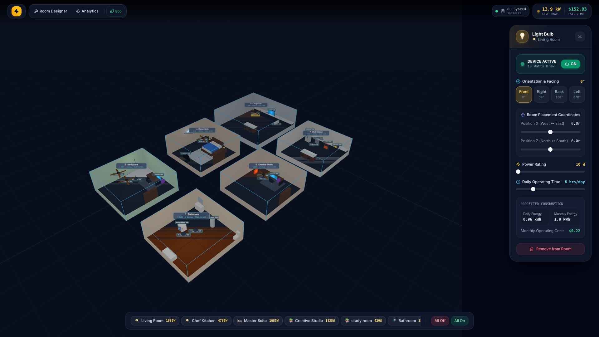

# ⚡ SmartHome 3D — Immersive Household Electricity Simulation

An interactive 3D smart home simulator and real-time household electricity management system built with **Three.js**, **React 18**, **TypeScript**, and **Tailwind CSS**. Users can architect custom rooms, furnish interiors, position electrical appliances, inspect real-time power draw, and explore the house in both an **architectural isometric view** and a **first-person walk (FPV) mode**.

---

## 🎬 Project Video & Live Demonstration

### 📹 Interactive Simulation Walkthrough
> Experience the 3D smart home in action — walking through rooms, toggling appliances, adjusting wattage, and monitoring energy analytics in real-time.



▶️ **[Download / Watch High-Definition Video (MP4)](docs/media/smart-home-3d-demo.mp4)**

---

## 📸 Screenshots & Interface Showcase

### 🏠 1. 3D Architectural Overview
> Isometric perspective of the entire multi-room household with real-time lighting, appliance glows, and live top-bar energy telemetry.



---

### 🎮 2. First-Person View (FPV) Walkthrough
> Physically walk through rooms using `WASD` and mouse look. Interactive reticle highlights appliances, showing live wattage draw, daily consumption, and instant toggle hotkeys (`[E]`).



---

### 📊 3. Real-Time Energy Analytics Dashboard
> Complete energy audit metrics: total wattage draw, daily & monthly kilowatt-hour projections, monthly utility bill estimates, dynamic energy efficiency grade ($A+$ to $D$), load category breakdown, and room-by-room distribution with one-click **Eco Mode**.



---

### 🛠️ 4. Room & Architecture Designer
> Customize room dimensions, wall colors (Nordic Slate, Modern White, Deep Navy, Sage Green), flooring materials (Walnut, Birch, Marble, Slate), and spawn curated furniture sets.



---

### ⚙️ 5. Appliance Inspector & Power Tuner
> Select any appliance to tune rated wattage, estimated daily operating hours, 4-way orientation, and room coordinates with live power calculations.



---

## ✨ Core Features

### 🎮 1. First-Person View (FPV) & 3D Walkthrough
- **Real-Time FPV Exploration**: Physically walk through rooms with `WASD` / Arrow keys and realistic mouse-look.
- **Interactive Appliance Reticle**: Point at any appliance to inspect its wattage, daily consumption, and live status.
- **Instant Hotkey Interaction**: Press `[E]` or left-click to toggle any appliance on/off in real-time.
- **Quick Room Navigation**: Teleport or walk between the Living Room, Chef Kitchen, Master Suite, Creative Studio, and Bathroom.
- **Dynamic Enclosure**: Ceilings and full-height walls dynamically activate in FPV mode for an authentic interior atmosphere.

### 🏠 2. Multi-Room Architectural Customization
- **Room Types**: Living Room, Master Bedroom, Chef Kitchen, Creative Studio, Study Room, and Bathroom.
- **Thematic 3D Furniture**:
  - **Living Room**: Sectional sofa with cushions, walnut coffee table, media console, houseplant, and area rug.
  - **Master Suite**: Double bed with mattress, pillows, nightstands with lamps, bedroom rug, and wardrobe.
  - **Kitchen**: L-shaped quartz countertops, stainless steel sink with faucet, kitchen island with bar stools.
  - **Creative Studio**: Executive desk, ergonomic mesh chair, dual monitor gaming setup with RGB tower, and bookshelf.
- **Aesthetic Customization**: Wall paint palettes (*Nordic Slate, Warm Cream, Modern White, Sage Green, Deep Navy*) and flooring materials (*Rich Walnut, Light Birch, Marble, Dark Slate*).

### ⚡ 3. Electrical Appliances & Flexible Placement
- **Supported Appliances**:
  - 💡 **Light Bulb & Chandelier Fixtures** (10W)
  - 🌀 **Aerodynamic Ceiling Fans** (75W) with live rotation animation
  - ❄️ **Split Air Conditioners** (1,500W) with LED temperature readout and cool air glow
  - 📺 **OLED 65" Televisions** (100W) with ambient wall backglow
  - 🧊 **French-Door Refrigerators** (150W) with water/ice dispenser
  - 🫧 **Front-Load Washing Machines** (500W) with porthole door
  - 🔥 **Oven & Range Cooktops** (2,400W) with glowing induction burners
  - 📡 **Countertop Microwaves** (1,000W)
  - 💻 **High-End PC & Dual Monitor Setups** (250W)
  - ♨️ **Radiator Space Heaters** (1,500W) with infrared thermal glow
  - 🍽️ **Under-Counter Dishwashers** (1,200W)
  - 🚿 **Water Heaters & Boilers** (3,000W)
- **Flexible Orientation**: 4-way rotation (`Front 0°`, `Right 90°`, `Back 180°`, `Left 270°`).
- **Precision Coordinates**: Adjust position along room X and Z axes with live coordinate sliders.
- **Custom Power Tuning**: Adjust rated wattage (5W – 4,000W) and estimated daily operating hours (0.5h – 24h).

### 📊 4. Electricity Analytics & Management Dashboard
- **Household Metrics**:
  - Live Wattage draw ($W / kW$)
  - Projected daily electricity consumption ($kWh$)
  - Projected monthly consumption ($kWh$)
  - Estimated monthly utility bill (at standard \$0.12/kWh rate)
- **Efficiency Grading**: Dynamic energy audit grade ($A+, A, B, C, D$) based on current demand.
- **Category Breakdown**: Proportional energy distribution across Climate/AC, Kitchen, Entertainment/Tech, Lighting, and Heating.
- **Room-Level Insights**: Comparative load analysis across all rooms with active device counts.
- **One-Click Eco Mode**: Intelligently switches off high-load devices (ACs, heaters, ovens) while maintaining essential appliances.

---

## ⌨️ Controls & Navigation

| Mode | Control | Action |
|------|---------|--------|
| **3D Builder View** | Left-Click + Drag | Orbit / rotate camera |
| **3D Builder View** | Mouse Scroll | Zoom in / out |
| **3D Builder View** | Click Appliance | Select & open Inspector Panel |
| **3D Builder View** | Click "Walk Inside Room" | Enter room in First-Person View |
| **FPV Walk Mode** | `W` `A` `S` `D` | Walk Forward / Left / Back / Right |
| **FPV Walk Mode** | Mouse | Look around |
| **FPV Walk Mode** | `E` Key / Click | Toggle hovered appliance |
| **FPV Walk Mode** | Click Canvas | Lock mouse cursor for seamless look |
| **FPV Walk Mode** | Click "Return to 3D" | Exit back to Architectural View |

---

## 🛠️ Tech Stack

- **Three.js** — WebGL 3D graphics, procedural lighting, shadows, raycasting, animated meshes
- **React 18 & TypeScript** — Component architecture and type-safe state flows
- **Zustand** — High-performance reactive state management for rooms, appliances, and energy telemetry
- **Tailwind CSS** — Glassmorphism dark UI HUD overlay and responsive panels
- **Web Audio API** — Procedural sound synthesis for switches and Eco mode
- **Vite** — High-speed build tooling and local database API plugin

---

## 🚀 Getting Started

### Prerequisites
- Node.js (v18 or higher recommended)
- npm or yarn

### Installation & Run

```bash
# 1. Clone the repository
git clone https://github.com/Yuvansh-thx/smarthome-3d-energy-simulator.git
cd smarthome-3d-energy-simulator

# 2. Install dependencies
npm install

# 3. Start development server
npm run dev
```

Open `http://localhost:5173/` in your browser.

### Production Build

```bash
npm run build
npm run preview
```

---

## 📄 License

This project is licensed under the MIT License.
